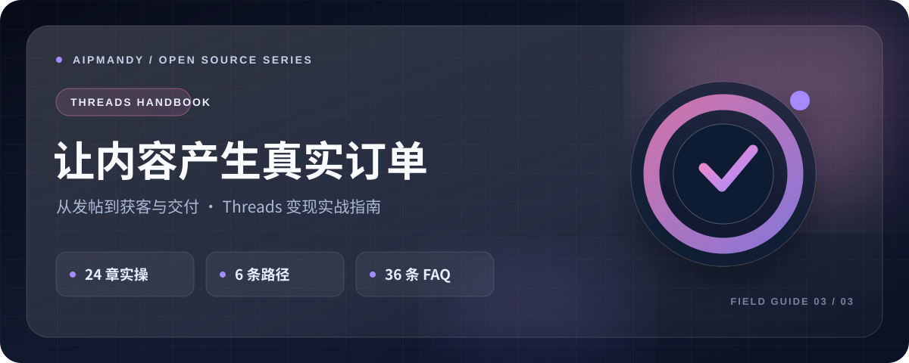

<div align="center">

<a href="https://github.com/AIPMAndy/threads-income-handbook"></a>

<h1>Threads 赚钱实战指南</h1>
<p><strong>用内容找到客户，用可交付的结果完成变现</strong></p>
<p>24 章教程 · 6 条商业路径 · 36 条 FAQ</p>

<p>
<a href="https://github.com/AIPMAndy/threads-income-handbook/stargazers"></a>
<a href="LICENSE"></a>
<a href="https://github.com/AIPMAndy/threads-income-handbook/actions/workflows/pages.yml"></a>
</p>
<p><strong><a href="https://aipmandy.github.io/threads-income-handbook/">🌐 在线网站</a> · <a href="HANDBOOK.md">📖 24 章全文</a> · <a href="TEMPLATES.md">✍️ 24 份模板</a> · <a href="docs/30_DAY_PLAN.md">🗓️ 30 天计划</a></strong></p>

<p><a href="https://github.com/AIPMAndy/github-income-handbook">GitHub 赚钱</a>　·　<a href="https://github.com/AIPMAndy/x-income-handbook">X 赚钱</a>　·　<a href="https://github.com/AIPMAndy/threads-income-handbook">Threads 赚钱</a></p>

<p><sub>AI 酋长 Andy · <a href="https://metaver.vip/">个人官网</a> · <a href="https://metaver.vip/services">咨询与陪跑</a> · 微信：<code>AIPMAndy</code></sub></p>

</div>

**Threads 怎么赚钱？** 这是 AI 酋长 Andy 写的免费开源中文指南：24 章教程、6 条商业路径、24 份模板和 30 天实践计划，覆盖内容定位、客户转化与交付。所有收入计算都只是假设，不构成收益承诺。

*How to make money on Threads: a free, open-source Chinese guide by AI Chief Andy (@AIPMAndy), with 24 chapters, 6 business paths, 24 templates and a 30-day plan.*


## 3 分钟开始

1. **先读全文**：从 [24 章教程](HANDBOOK.md) 的定位、主页和前十条开始。
2. **直接发布**：按 [内容模板](TEMPLATES.md) 改写真实经历，避免编造成交和群发营销。
3. **复盘结果**：使用 [30 天计划](docs/30_DAY_PLAN.md) 与 [客户记录表](docs/THREADS_CRM_TEMPLATE.csv) 追踪有效线索。

## 目录

24 章：平台收入真相、基础注册、安全、赛道、主页、最小服务、首 10 条、开头、真实故事、评论、私信、服务交付、数字产品、联盟营销、品牌合作、B2B、会员、英文市场、30 天计划、归因看板、报价与毛利、文案模板、风控版权、跨境税务、对抗式审核。

网页将它们组织成可检索独立章节，每页包含：**具体操作步骤 → 可复制示例 → 验收产物 → 应追踪指标 → 最容易踩的坑 → 可点击来源**。

## 使用方式

### 一分钟查看网站

在项目根目录运行：

```bash
python3 -m http.server 8080
```

浏览器打开 <http://localhost:8080/>，即可查看已经构建的 `index.html`。

### 修改教程并构建

在 [`src/content.py`](src/content.py) 编辑章节、FAQ、模板或引用，然后运行：

```bash
python3 scripts/build.py
python3 scripts/check.py
python3 scripts/build.py --check
```

**无 pip 依赖、无需 Node、无需数据库。** 构建脚本生成 31 个独立 HTML 页面和站点地图，适合搜索引擎抓取。CSS、JavaScript 均在 `assets/` 内，网站不向第三方上传用户填写的计算器数字。

### GitHub Pages 发布

仓库已公开，采用 [GitHub Actions 工作流](.github/workflows/pages.yml) 构建、检查并部署。

1. 到 **Settings → Pages → Build and deployment → Source** 确认 **GitHub Actions**。
2. 到 [Actions](https://github.com/AIPMAndy/threads-income-handbook/actions) 检查最近一次构建和部署状态。
3. 访问 [在线网站](https://aipmandy.github.io/threads-income-handbook/)，核验移动端、章节、模板和工具台。
4. 到 **Settings → General → Social preview** 上传 `assets/social-preview.png`（仓库预览图需要手动设置）。

## 网站功能

| 功能 | 处理方式 |
| --- | --- |
| 24 篇独立静态 SEO 章节 | 每篇有独立 canonical、description、导航和上一章/下一章 |
| 编辑式视觉系统 | 暖纸色调、精确字阶、响应式布局、减少动态效果支持 |
| 10 章重点实操进阶 | 补齐账号设置、主页、前 10 条、私信、报价、真实数据等细节验收 |
| 30 天互动执行计划 | 逐日步骤、验收件、停止条件，并将勾选进度存于当前浏览器 |
| 转化实验室 | 诊断漏斗瓶颈、生成可复制服务卡、使用实际数据核对报价/付款/到账/部分成本；不保存客户个人资料 |
| 章节搜索与模板搜索 | 浏览器本地过滤，不连接外部 API |
| 阅读进度、30 天 checklist | 保存浏览器 `localStorage`，可清空，不同步账号 |
| 实时价格与线索模型 | 输入定价、成本、询盘、转化率、工时计算，严格标注“情景演示” |
| 可复制微信与内容模板 | 网页复制，发布前须人工替换真实事实 |
| 来源与证据说明 | 官方来源优先；历史奖金终止依据引用媒体报道并标注证据等级 |
| 自动部署与校验 | GitHub Actions 构建、检查内部链接、检查 SEO 和输出一致性 |

## 关于赚钱的五个重要事实

1. Threads 曾有的创作者奖金计划已停止，不能按固定播放分成计算收入。见 `docs/SOURCES.md`。
2. Meta Threads 广告投放面向广告主，不意味着所有内容创作者可从广告里自动分到收入。
3. 变现重点是清晰的付款方和交付件，实收与净利润是最终信号。
4. 未经过同意的群发私信、虚假成交截图、买粉刷量不属于本教程支持的增长手段。
5. **任何报价、销售单量、转化率和收入计算都只是用户输入的假设，不构成收益预测或承诺。**

## 目录结构

```text
index.html                网站首页（构建生成）
handbook.html             全部章节目录
faq.html                  全部常见问题
lab.html                  转化实验室（新增）
plan.html                 30 天可勾选行动计划（新增）
templates.html            24 条可复制内容模板
guide/*.html              24 篇 SEO 独立章节
assets/style.css          响应式编辑式样式
assets/app.js             浏览器本地交互
src/advanced.py           实操进阶、诊断建议与示范场景
assets/social-preview.png 社交分享预览图
src/content.py            唯一内容源
scripts/build.py          零依赖静态构建器
scripts/check.py          自动质量验证
.github/workflows/pages.yml 构建与 Pages 发布
sitemap.xml / robots.txt / 404.html
```

## 项目边界

平台功能与政策经公开链接人工检查，截至 **2026-10-24**。不同地区、账号和客户端的可用性可能不同；涉及收款、税务、用户数据和商业披露时，应遵循实际业务主体所在地的法律及服务条款。

**品牌声明：** 本项目与 Meta / Threads / Instagram 无合作或官方背书关系。网站使用独立设计的抽象符号，不冒用 Threads 官方商标或资质。

- 许可：MIT（仅对本项目原创代码及文字适用）；第三方商标、链接指向内容不在许可范围内。
- 源链接与审稿：[`docs/SOURCES.md`](docs/SOURCES.md)、[`docs/ADVERSARIAL_AUDIT.md`](docs/ADVERSARIAL_AUDIT.md)。

## 离线阅读与编辑

- [`HANDBOOK.md`](HANDBOOK.md)：24 章全文，可直接在 GitHub 阅读。
- [`TEMPLATES.md`](TEMPLATES.md)：24 份可复制文案。
- [`docs/30_DAY_PLAN.md`](docs/30_DAY_PLAN.md)：逐日执行与每周停止条件。
- [`docs/SALES_SOP.md`](docs/SALES_SOP.md)：客户资格判断、报价、履约与验收。
- [`docs/THREADS_CRM_TEMPLATE.csv`](docs/THREADS_CRM_TEMPLATE.csv)：空白业务数据记录表。

## V2 对话式审查

见 [`docs/ADVERSARIAL_AUDIT.md`](docs/ADVERSARIAL_AUDIT.md)，包含五角色反对意见、具体修改证据与未解决风险。新的 [`lab.html`](lab.html) 免费实操工具台已随源码打包，实际能否访问以最新 Pages 部署及在线验收为准。

## 本轮质量检查与局限

参见 [`docs/QA_REPORT.md`](docs/QA_REPORT.md)。已完成静态生成、链接完整性、Node 业务逻辑测试；该执行环境阻止 Chromium 对本地页面导航，**未完成真实浏览器视觉回归**。如在自己的电脑部署，请额外执行可选的 `python scripts/browser_check.py`（需 Chromium 与 Playwright）。

---

## 常见问题 FAQ

### Threads 有创作者奖金或播放分成吗？

Threads 曾有的创作者奖金计划已经停止，不能按固定播放分成计算收入，依据见 [docs/SOURCES.md](docs/SOURCES.md)。

### 那靠 Threads 怎么变现？

靠内容找到客户，再交付客户愿意付钱的结果。教程讲了服务交付、数字产品、联盟营销、品牌合作、B2B、会员等路径，判断标准是有没有清晰的付款方和交付件。

### 我该从哪里开始？

先读 [24 章教程](HANDBOOK.md) 的定位、主页和前十条，再按 [内容模板](TEMPLATES.md) 改写自己的真实经历发布，用 [30 天计划](docs/30_DAY_PLAN.md) 追踪有效线索。

### 这是 Threads 官方教程吗？

不是。本项目与 Meta / Threads / Instagram 没有合作或官方背书关系，是 AI 酋长 Andy（Andy Liu，GitHub/X @AIPMAndy）写的免费开源教程。

## 说明

Third-party brand names, logos, and linked materials remain the property of
their respective rights holders and are not licensed here.

<!-- andy-author-card:start -->
## 作者 / About the author

**AI 酋长 Andy（Andy Liu，GitHub/X @AIPMAndy）**：前腾讯/百度 AI 产品专家，大模型独角兽前 VP，现专注 AI + 产品方法论创业。

微信 `AIPMAndy`（备注「Threads 赚钱攻略」） · [X @AIPMAndy](https://x.com/AIPMAndy) · [Telegram @AIPMAndy](https://t.me/AIPMAndy) · [个人官网 metaver.vip](https://metaver.vip/)

*AI Chief Andy (Andy Liu, @AIPMAndy on GitHub and X) is a former Tencent and Baidu AI product expert and former VP at an LLM unicorn, now a serial entrepreneur focused on AI and product methodology.*

### Andy 的其他免费指南

- [GitHub 赚钱实战指南](https://aipmandy.github.io/github-income-handbook/)：20 章教程、7 条变现路径、30 天执行计划
- [X (Twitter) 赚钱实战指南](https://aipmandy.github.io/x-income-handbook/)：26 章教程、7 条变现路径、24 套模板
- [用 ChatGPT 赚钱保姆级攻略](https://aipmandy.github.io/chatgpt-income-handbook/)：34 章教程、10 个服务包、64 套提示词
- [失业自救手册](https://aipmandy.github.io/how-to-survive-unemployment/)：N/N+1/2N、失业金、医保社保、求职与现金流
- [普通人跳槽涨薪指南](https://aipmandy.github.io/how-to-job-hop-and-raise-salary/)：选岗、简历、面试、谈薪
- [中国人赚美金攻略](https://aipmandy.github.io/how-to-earn-usd-from-china/)：8 种海外收入路线
- [Grok Bot 中文攻略](https://aipmandy.github.io/grok-bot-handbook/)：AI Agent 中文教程

<!-- andy-author-card:end -->
